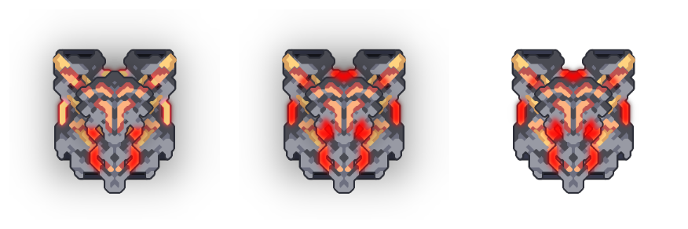
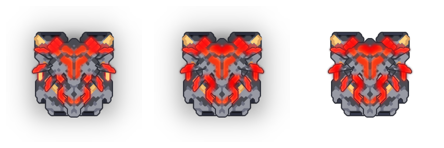
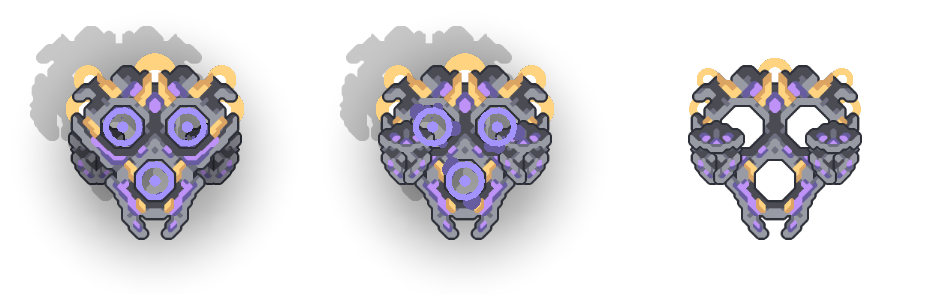
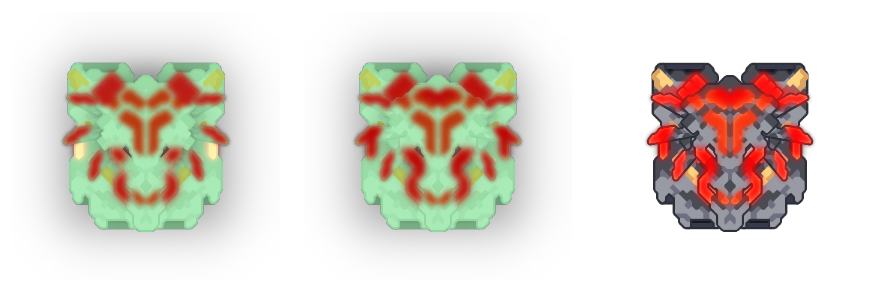
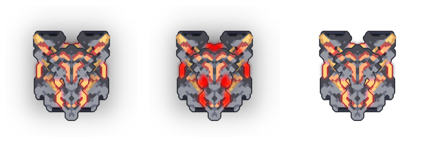
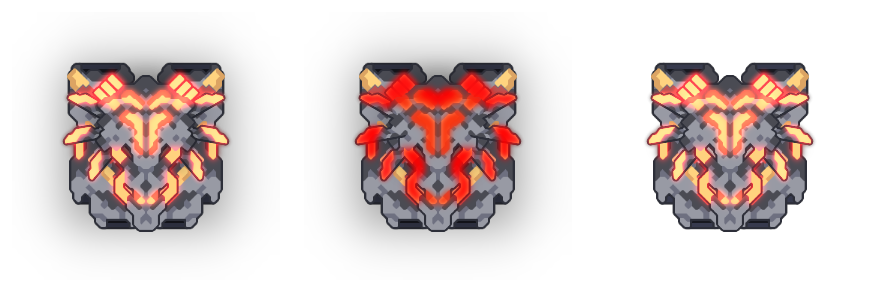
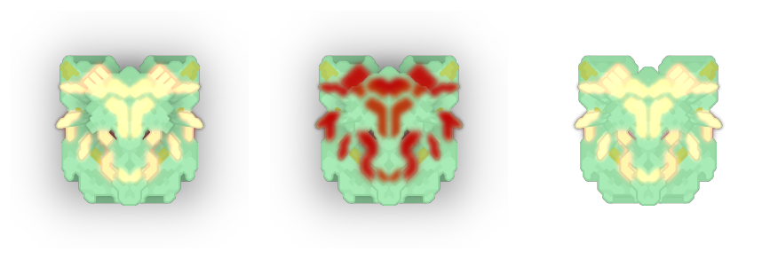

# Цвета полноценных проекций: причины и варианты решения

Mindustry **v160.7 / Arc 7445105cd2**, 18 ноября 2026. Ниже сохранено исходное исследование для выбора реализации. **Выбранный вариант A реализован**; уточнение тестового эталона и повторные измерения приведены в заключительном разделе. Исправления камеры и структурных единиц выполнены отдельно.

## Результат исследования

У Завоевателя действительно есть избыточная краснота относительно штатного изображения при одинаковом состоянии. Главная подтверждённая причина — **порядок наложения деталей**, включая обводки и тепловые слои. Часть различий у других типов обусловлена упрощёнными цветовыми/эффектными формулами адаптера. Подмена красного на жёлтый не устраняет эти причины.

При этом красный не целиком ошибочен: в [определении Завоевателя](https://github.com/Anuken/Mindustry/blob/v160.7/core/src/mindustry/content/UnitTypes.java#L3004) заданы `Color.red`, heatColor `f9350f` и `(1, 0.1, 0.1)`. Правильный итоговый жёлто-оранжевый цвет получается из текстур, состояния и композиции; нельзя заменять все такие значения единой «правильной» краской.

## Сравнение в настоящем клиенте

В изолированном SDL/OpenGL-клиенте с BuildWheel использовались настоящие игровые UnitType и один и тот же объект юнита для трёх проходов:

1. **Штатный UnitType.draw с Z-сортировкой**, как в мировом рендере.
2. **Тот же UnitType.draw без Z-сортировки** — диагностическая проверка влияния порядка, без изменения его цветовых формул.
3. **Нынешняя полноценная проекция**, масштаб `P / hitSize = 3`, без смещения.

Время фиксировано; одинаковы направление, mounts, warmup, reload, отдача, heat, здоровье, hitTime/healTime, drownTime и щит. Проверены Завоеватель, Окт, Власть, Разрушение (disrupt), Затмение: **5 типов × 7 состояний × 3 прохода = 105 FBO-отрисовок**. Состояния: покой, половинный разогрев, полный разогрев/отдача, повреждение, лечение, погружение и щит.

Это штатный рисунок юнита в тестовом FBO, а не полный кадр карты: мировой фон, итоговое освещение сцены и внешние постэффекты здесь отсутствуют. Такие различия нельзя смешивать с ошибкой адаптера. Вызов UnitType.draw используется только в одноразовом исследовательском сценарии; он не добавлен в HUD. У исходного draw есть побочные эффекты, например изменение shadowAlpha и отправка света в мировой renderer.

### Измерения Завоевателя

Для воспроизводимого подсчёта «красным» считается непрозрачный пиксель с R > 80 и R > 1,6×G/B, «жёлтым» — R > 100, G > 80, G > 1,4×B и R < 2×G. Это диагностическая классификация оттенков, а не универсальная оценка воспринимаемого цвета.

| Состояние / проход | Красные пиксели | Жёлтые пиксели | Средняя ошибка RGB относительно штатного sorted |
| --- | ---: | ---: | ---: |
| Покой, штатный sorted | 3 875 | 2 103 | 0 |
| Покой, штатный immediate | 5 552 | 1 468 | 6,649 |
| Покой, проекция | 5 486 | 1 438 | 9,217 |
| Полный разогрев, штатный sorted | 8 875 | 1 063 | 0 |
| Полный разогрев, штатный immediate | 9 886 | 860 | 7,059 |
| Полный разогрев, проекция | 9 820 | 861 | 8,179 |

Ошибка — среднее абсолютное различие одного RGB-канала, диапазон 0–255, на пикселях с alpha > 0,5 в обоих изображениях. Она включает также различия геометрии/обводок; это не изолированная ошибка цветовой формулы. Сравнение двух штатных проходов выделяет влияние сортировки значительно надёжнее: меняется режим сортировки, цветовые формулы остаются теми же.

В покое у проекции примерно на 42% больше классифицированных красных пикселей и на 32% меньше жёлтых. Штатный immediate становится очень похожим на проекцию — избыточная краснота воспроизводится без замены единого исходного цвета.

На иллюстрациях слева направо: **штатный sorted → штатный immediate → нынешняя проекция**. Масштаб в колонках одинаковый, пустые края кадра обрезаны одинаково.

### Другие типы и состояния

| Тип | Ошибка RGB в покое | При лечении | При погружении |
| --- | ---: | ---: | ---: |
| Завоеватель | 9,217 | 60,357 | 36,340 |
| Окт | 0,133 | 43,795 | 45,612 |
| Власть | 3,540 | 48,050 | 39,985 |
| Разрушение | 13,563 | 63,827 | 37,546 |
| Затмение | 0,273 | 55,168 | 39,552 |

У Разрушения заметное расхождение присутствует уже в покое; у Окта и Затмения общие непрозрачные пиксели в покое близки. При лечении и погружении расходятся все пять типов. Поэтому проблема не ограничена одним юнитом или красной текстурой.

## Причины и аудит поддержанных эффектов

| Механизм | Штатный v160.7 | Нынешний адаптер / следствие |
| --- | --- | --- |
| Слои RegionPart | [RegionPart.draw](https://github.com/Anuken/Mindustry/blob/v160.7/core/src/mindustry/entities/part/RegionPart.java#L70) использует layer, layerOffset, outlineLayerOffset и отдельный тепловой слой; SpriteBatch сортирует команды | Порядок вызовов определяется обходом частей, числовые приоритеты слоёв не воспроизводятся. Поздняя непрозрачная деталь может закрыть предыдущую цветную/нагретую область |
| Завоеватель: blades/обводки/heat | В трассе обводки sides/sinks имеют Z ≈ 60,109, их тела 60,110, blades ≈ 60,108, heat ≈ 61,108–61,110 | Все эти изображения рисуются сразу по порядку обхода. Особенно заметны перекрытия нескольких blades, обводок и тепла |
| Цвет и mixColor обычной части | Интерполяция color→colorTo и mixColor→mixColorTo по прогрессу | Основная формула совпадает при alpha HUD = 1. Цветовая подмена не является первым исправлением |
| Alpha тепловой части | `hprog × heatColor.a`, затем [Drawf.additive](https://github.com/Anuken/Mindustry/blob/v160.7/core/src/mindustry/graphics/Drawf.java#L194) | Используется alpha HUD × hprog; heatColor.a потеряна. Для полупрозрачных настроек частей возможен избыточный нагрев. Это подтверждено формулами, отдельно от основной ошибки порядка Завоевателя |
| Тепло основного оружия | [Weapon.draw](https://github.com/Anuken/Mindustry/blob/v160.7/core/src/mindustry/type/Weapon.java#L218): heatColor, mount.heat, additive | Базовая формула близка, но окружение/обводки/порядок частей могут менять итоговую композицию |
| Повреждение / лечение / вода | [UnitType.applyColor](https://github.com/Anuken/Mindustry/blob/v160.7/core/src/mindustry/type/UnitType.java#L1986) учитывает hitTime, healFlash/healColor/healTime и lastDrownFloor | Адаптер воспроизводит белую вспышку hitTime, но не полную формулу лечения и погружения. Подтверждено пятью типами в FBO |
| Цвет ячейки здоровья | [UnitType.cellColor](https://github.com/Anuken/Mindustry/blob/v160.7/core/src/mindustry/type/UnitType.java#L1797): чёрный→командный цвет и пульсация здоровья | Основная формула цвета ячейки близка. До неё отличается применяемый общий mixColor |
| Двигатели | [UnitEngine.draw](https://github.com/Anuken/Mindustry/blob/v160.7/core/src/mindustry/type/UnitType.java#L2018): радиус 1–1,25 от настройки, engineColorInner, смещённый внутренний круг | Здесь радиус 0,8–1, внутренний круг белый, другого размера и без штатного смещения. Это различие геометрии и окраски, не только alpha |
| Щит | [UnitType.drawShield](https://github.com/Anuken/Mindustry/blob/v160.7/core/src/mindustry/type/UnitType.java#L1643): shieldAlpha, радиус 1,3×hitSize и мягкое заполнение | Проекция показывает условный шестиугольник радиуса 0,65×hitSize при shield > 0. Это ранее выбранный индикатор, который нельзя выдавать за точную копию щита |
| Горение / плавление | [StatusEffect.update](https://github.com/Anuken/Mindustry/blob/v160.7/core/src/mindustry/type/StatusEffect.java#L164) создаёт отдельные мировые частицы; у стандартного UnitType.draw нет аналогичного кольца | В HUD это пульсирующее кольцо-индикатор. Его оттенок и форма намеренно условны; точные огненные FX требуют механизма объектов из второго отчёта, а не перекраски корпуса |
| Ноги / мехи / гусеницы | [UnitType.drawTank/drawLegs](https://github.com/Anuken/Mindustry/blob/v160.7/core/src/mindustry/type/UnitType.java#L1806) и drawMech применяют штатное общее окрашивание и собственный порядок примитивов | Читаются настоящие позы и кадры, но сложные соединения/качание меха и тени воспроизводятся не полностью. Общие отличия лечения/воды касаются и этих примитивов; гусеницы и мехи присутствовали в FBO-проверке Завоевателя и Власти |
| Корпусные части / обводки оружия | Исходники задают конкретные точки обхода и Z; корпусные parts обходятся после оружия | Разделение under/above в адаптере не полностью эквивалентно штатному порядку. Нужна сверка всей поддержанной цепочки, не только одной красной детали |
| Подсветка выбора | [OverlayRenderer.checkApplySelection](https://github.com/Anuken/Mindustry/blob/v160.7/core/src/mindustry/graphics/OverlayRenderer.java#L272) добавляет временный mixColor | В адаптере не воспроизводится. В численных сравнениях покоя у нового юнита такого mixColor не было, поэтому он не объясняет приведённый результат |
| Свет / Bloom / мировые частицы | Часть общего рендера мира, а не только UnitType.draw | Не воспроизводятся в HUD; добавление FBO само по себе не возвращает полный мировой pipeline |

У частей оружия `turretShading = false`, что явно устанавливается в [Weapon.load](https://github.com/Anuken/Mindustry/blob/v160.7/core/src/mindustry/type/Weapon.java#L582). Поэтому тепловые слои Завоевателя в этой проверке находятся на `prevZ + heatLayerOffset`, а не на фиксированном слое turretHeat. Это существенная деталь версии API.

## Варианты реализации для выбора

### A. Подготовленный порядок операций в существующем адаптере — рекомендуется

Использовать те же данные типов и текущие Unit/mount-состояния. Для поддержанных примитивов один раз подготовить последовательность рисования с правильными layer/outline/heat-приоритетами и порядком оружия/корпуса. Динамические преобразования и прогресс вычислять один раз на часть, переиспользуя буферы. Для разных штатных базовых слоёв/состояний выбирать подготовленный вариант без перерасчёта HUD.

В той же реализации привести цветовые формулы к целевой версии: alpha тепловых частей, общий mixColor лечения/воды/повреждения, согласованные сбросы/восстановление состояния. Нечисловые данные проверять до отправки в Draw. Параметры UnitType и настоящих юнитов не менять; виртуальные мировые draw не вызывать.

Плюсы: сохраняется единый UnitProjection, нет покадровой сортировки примитивов, новых игровых обходов или цветовых исключений по имени юнита. Подходит и для других типов с поддержанными частями. Цена — более тщательная подготовка порядка и тесты разных комбинаций слоёв; на момент исходного исследования это был ещё не реализованный прототип. Произвольная смена метаданных слоёв после загрузки потребует инвалидизации плана либо варианта B; обычные изменения позы/прогресса читаются без перестройки.

Геометрические упрощения двигателей/щита следует выбирать отдельно от исправления цветов. Если нужен их точный штатный размер, необходимо согласованно изменить ProjectionBounds и проверить вписывание заново: максимум двигателя 1,25 и щит 1,3×H нельзя просто дорисовать в нынешнем резерве.

### B. Локально сортируемый поток примитивов

Сохранить безопасный адаптер данных и исправить те же цветовые формулы, но задавать настоящие относительные Z и сортировать переиспользуемый поток/батч каждой проекции. Это проще для меняющихся и нестандартных комбинаций слоёв, чем заранее готовить все порядки.

Плюсы: более прямое соответствие штатной модели Z, проще проверять перестановки. Минусы: покадровая подготовка/сортировка и дополнительные flush при изоляции проекций от Scene, потенциально до 11 проходов. Нужно восстанавливать batch, матрицы, shader, blend, scissor и остальные состояния; одного Draw.z недостаточно при обычном несортируемом UI-проходе. Буферы можно переиспользовать, но стоимость CPU/GPU необходимо измерить.

### C. Штатный рендер юнита в отдельном FBO

Даст более широкое соответствие исходному рисунку, если воспроизвести также окружение, сортировку и нужные shader-проходы. Однако UnitType.draw может менять shadowAlpha, смещать объект меха на время рисования, добавлять свет, вызывать abilities и сторонние overrides. FBO изолирует изображение, а не побочные эффекты Java-кода. Без отдельной изоляции состояния это не универсальный безопасный способ, а с ней растут сложность и стоимость. Для текущего приоритета эффективности не предлагается первым.

### D. Локальная подмена цвета Завоевателя — последний метод

Можно отдельно заменить оттенки его конкретных HUD-слоёв, не меняя мировой UnitType. Это дёшево, но скрывает ошибку порядка, ухудшает соответствие разным фазам нагрева и не исправляет Разрушение, лечение, воду и модифицированные типы. Потребуется ручной подбор и сопровождение исключений. Рекомендуется лишь как сознательно выбранная стилизация после отказа от универсального исправления.

## Что проверять после выбора

Повторить 105 сопоставлений, дополнить их прозрачностью HUD, разными командами, прогрессом 0/0,5/1, вложенными/зеркальными частями и heatColor.a < 1. Проверить прямые vertex/color-трассы, фактические пиксели и восстановление Draw/OpenGL. Отдельно измерить CPU/GPU и аллокации на 1/11 проекциях. Если меняются размеры эффектов — повторить геометрию и граничные позы; сохранённые ручные масштабы и разрешённое переполнение остаются действующими.

Пересоздаваемые данные исследования: `build/reports/smoke/projection-colors.csv`, `projection-color-commands.csv`, `colors-*.png`; воспроизведение — обычная задача smoke. Иллюстрации выше сохранены вместе с этим отчётом, чтобы последующие сборки не меняли его исходные свидетельства.

## Реализованный вариант A

В существующем адаптере используется подготовленный `ProjectionPlan`, хранимый вместе с метаданными UnitProfiles. Воспроизведены слои, стабильные равные ключи сортировки Arc, порядок обводок/корпуса/оружия, зеркальных сторон и детей. Корпусные parts обходятся после оружия. Динамические mount-позы, прогресс, преобразования и цвета переиспользуются; сортировки в кадре нет. Исключений по имени Завоевателя нет.

Исправлены heatProgress × heatColor.a, интерполяция RGBA color/mixColor, наследование между сторонами и восстановление для детей. Собственные цвета применяются только к найденному базовому региону; heat-only не наследует неиспользованную интерполяцию. У основного оружия heatColor.a заменяется mount.heat, как в штатном Weapon.draw. Прозрачность HUD умножается на alpha каждого цвета.

Общее окрашивание включает healFlash/healColor/healTime, hitTime, погружение и штатную подсветку выбора. Погружение заменяет mix лечения/повреждения. Мехи сохраняют собственные цвета шага/жидкого пола; UnderwaterMovec — полный mix пола. При healFlash=false повреждение использует устойчивый белый, без зависимости от остаточного Tmp.c1.

Прямые штатные вызовы выявили уточнение: **applyOutlineColor и окраска основания меха** передают Tmp.c1 вторым аргументом Draw.color, который сам перезаписывает этот объект первым аргументом. Фактический draw-color в целевой паре Mindustry/Arc белый; независимый mix погружения действует. Адаптер воспроизводит это измеренное поведение. Исходная таблица описывала формулу UnitType без учёта alias.

Цвет внутреннего двигателя берётся из engineColorInner; alpha обоих цветов сохраняется. Радиусы 0,8–1, внутренний круг 0,45, центры и координаты двигателей оставлены прежними. Приведение их к мировой геометрии требует отдельной задачи вписывания. Щиты/горение остались прежними условными индикаторами; новые способности/частицы/эффекты и настройка «Дополнительная отрисовка» в этой правке не добавлялись.

### Дополнительная причина: смешивание UI

**SpriteBatch.setBlending этой Arc не делает flush.** В несортируемом UI прежняя пара additive → normal до отправки буфера могла фактически нарисовать heat обычным смешиванием. Новый helper отправляет накопленные вершины до фактической смены режима, включая восстановление состояния Scene. Смежные тепловые операции остаются одним участком. Одного исправления порядка и проверки вызовов Draw.blend было бы недостаточно.

В исходном FBO-эталоне обнаружен связанный эффект: SpriteBatch.flushRequests восстанавливает входной blend **до окончательной отправки последнего участка**. У изолированного юнита последний additive мог стать normal. В реальном Renderer после юнитов идут обычные overlay/space-проходы. Теперь эталонная очередь завершается normal-callback на Layer.end, без новых пикселей: он воспроизводит нужную границу очереди. Поэтому первоначальные значения native-sorted выше остаются исторической диагностикой, а не окончательным эталоном цвета. Прежнее сравнение sorted/immediate показывало общую ошибку композиции, включая жизненный цикл blend, а не изолировало только Z.

### Повторное сравнение

Пять настоящих типов × семь состояний × три режима — 105 FBO. Дополнительно сверены **727 операций**: порядок региона, RGB/alpha, mix и blending; в том числе вторая команда и alpha HUD 0,32. В трассе отдельно исключены непредставляемые способности, использующие тот же круг, что и двигатели; в полном пиксельном эталоне они сохранены. Автоматические тесты компонентов используют реальные методы UnitType/Weapon/RegionPart, включая вложенность, зеркальность, RGBA-интерполяцию, heatColor.a < 1, heat-only и прозрачность HUD.

Для корректного сравнения «до/после» исходная проекция взята из сохранённой третьей колонки иллюстраций выше, а эталон — из нового native-sorted с правильным завершением очереди. Размеры, обрезка и состояние совпадают (876×292, три одинаковые колонки); метрика прежняя — средняя ошибка RGB на общих непрозрачных пикселях, 0–255.

| Завоеватель | Исходная проекция против уточнённого эталона | Новая проекция |
| --- | ---: | ---: |
| Покой | 12,826 | 3,914 |
| Полный разогрев | 29,433 | 2,162 |
| Лечение | 91,113 | 4,664 |

При полном разогреве новая проекция содержит 4434 красных / 4441 жёлтый пиксель, уточнённый эталон — 4577 / 4446. Остаточная ошибка полного изображения ненулевая; она не является доказательством расхождения цветовой формулы. Командная трасса сверяется отдельно, геометрия двигателей и прежние границы поддержки мировых эффектов не расширены. Пиксельная идентичность всей мировой картинки не заявляется.

Новые иллюстрации, слева направо: **уточнённый native-sorted → native-immediate → исправленная проекция**.

Стоимость и полный перечень проверок — в актуальном разделе [VALIDATION.md](VALIDATION.md). Покадрового FBO или штатного мирового draw в моде не появилось; они используются только в тестовом клиенте.
